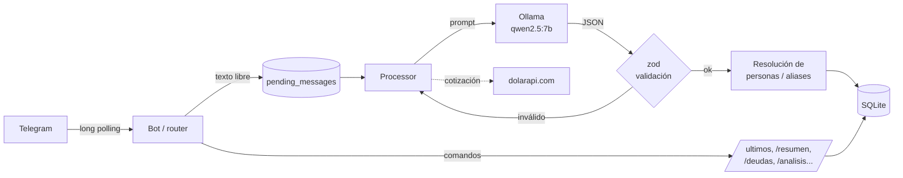

# expense-tracker 💸

Tracker de gastos personal que se usa **hablándole a un bot de Telegram como a un amigo**. Un LLM que corre **localmente** (Ollama) entiende mensajes en español rioplatense, los convierte en datos estructurados, los categoriza, detecta quién te debe plata y genera análisis mensuales en prosa.

```
vos:  ayer pagué 24000 de pizza con juan y caro, me deben su parte

bot:  ✅ #25 · $24.000 (USD 15,54) · comida/pizza · pizza con juan y caro · 2026-09-29

      deudas:
      · Juan te debe $8.000
      · Carolina te debe $8.000
```

En ese mensaje el modelo resolvió solo que *"ayer"* es una fecha concreta, que *"caro"* es un alias de Carolina, que la cuenta se divide entre 3 (vos incluido) y que *"24000"* son pesos. Además, el gasto se convirtió a dólares con la cotización MEP del momento.

## Qué hace

- **Registro en lenguaje natural**: `"15 lucas en el super"`, `"uber 4500"`, `"el sábado gasté 30k en un asado"`.
- **Categorización automática** en 13 categorías, con subcategoría libre (`comida/supermercado`, `transporte/uber`).
- **Deudas entre personas**: detecta quién te debe y cuánto, con aliases (`juancho` → Juan) y un comando para fusionar duplicados.
- **Doble moneda**: guarda cada gasto en ARS y en USD (cotización MEP de [dolarapi.com](https://dolarapi.com), cacheada 1h).
- **Análisis mensual con IA** (`/analisis`): el código calcula las estadísticas y el LLM las cuenta en prosa, comparando contra el mes anterior.
- **Edición y exportación**: `/editar 42 categoria=transporte`, `/borrar`, `/exportar` a CSV.
- **Privado por diseño**: el LLM corre en tu máquina, así que ningún gasto sale a una API externa.

## Arquitectura



Cada mensaje sigue este camino:

1. **Entra a una cola persistente** (`pending_messages`) antes de procesarse. Si la compu se apaga o Ollama está caído, no se pierde nada: al arrancar, el bot drena la cola.
2. **El LLM extrae un JSON estructurado.** El prompt incluye la fecha local, el día de la semana y las personas conocidas con sus aliases. Se usa `format: json` de Ollama (decodificación restringida por gramática).
3. **Se valida con zod.** Si el JSON está mal formado o no cumple el schema, se reintenta una vez. Si el modelo inventa una categoría, cae en `otros` en vez de fallar.
4. **Se clasifica el resultado**: gasto válido, no es un gasto (un saludo, por ejemplo), o hace falta aclarar algo (confianza < 0.7, falta el monto, etc.). En ese último caso, el bot repregunta en rioplatense.
5. **Se resuelven las personas** con un matching determinístico sobre nombres normalizados (sin tildes ni mayúsculas) contra el nombre canónico y los aliases. Si el nombre es nuevo, se crea la persona. Si hay ambigüedad, se usa el primer candidato y se le avisa al usuario para que corrija con `/fusionar`.

## Decisiones de diseño

| Decisión | Por qué |
|---|---|
| **LLM local (Ollama) en vez de una API** | Son datos financieros personales y no quiero mandarlos a terceros. Además, el costo por mensaje es cero. En una Mac con Apple Silicon, un 7B responde en 3–7s. |
| **Sin parser de regex "rápido"** | El diseño original tenía un pipeline doble (regex + LLM). Lo descarté porque duplicaba la superficie de bugs y los casos fáciles igual los resuelve el LLM. |
| **Stats en código, prosa en el LLM** | En `/analisis`, los números (totales, variaciones, top gastos) se calculan en TypeScript y el LLM solo los redacta. Los modelos chicos son malos haciendo cuentas. |
| **Resolución de personas determinística** | El LLM sugiere un nombre y el código decide a quién corresponde. Así, "juancho" nunca termina asignado a otra persona por una alucinación. |
| **Cola en SQLite, sin worker loop** | El bot corre en mi compu, no 24/7. Cada mensaje se procesa al llegar y los pendientes se drenan al arrancar. No hace falta Redis ni un proceso aparte para ~50 mensajes por día. |
| **Auditoría de cada llamada al LLM** | Cada prompt, respuesta, duración y versión de prompt se guarda en `logs/llm.jsonl`. Así se pueden depurar extracciones malas y comparar modelos o prompts. |
| **Errores del LLM tipados** | Distingue entre *Ollama caído* (el mensaje queda pendiente para reintentar), *timeout* y *error HTTP*, y en cada caso el usuario recibe un mensaje distinto. |

## Stack

TypeScript (strict) · Node 20+ · SQLite (`better-sqlite3`) · Ollama · `node-telegram-bot-api` · zod · pino · vitest

## Tests

```bash
npm test         # 54 tests
npm run typecheck
```

Los tests cubren la lógica pura: construcción de prompts, validación de schemas, normalización de categorías, resolución de personas y aliases, agregaciones mensuales, parser de `/editar`, cotización del dólar con caché y manejo de fechas locales.

## Correrlo

**Requisitos:** Node 20+, [Ollama](https://ollama.com) y un bot de Telegram (creado con [@BotFather](https://t.me/BotFather)).

```bash
brew install ollama && ollama serve &
ollama pull qwen2.5:7b          # o llama3.2:3b, más liviano

npm install
cp .env.example .env            # token del bot + tu user id de Telegram
npm start
```

### Modo demo

Para probarlo con datos realistas sin tocar la base real:

```bash
npm run seed:demo   # crea data/demo.db con 2 meses de gastos, personas y deudas
npm run demo        # arranca el bot usando esa DB
```

## Comandos

| Comando | Qué hace |
|---|---|
| *(texto libre)* | Registra un gasto |
| `/ultimos [n]` | Últimos N gastos |
| `/resumen [YYYY-MM]` | Total y desglose por categoría |
| `/analisis [YYYY-MM]` | Análisis en prosa generado por el LLM |
| `/deudas` · `/deuda <persona>` | Quién te debe y cuánto |
| `/saldar <id>` · `/saldar_todo <persona>` | Marcar deudas como pagadas |
| `/personas` · `/fusionar <id> <id>` | Gestión de personas y aliases |
| `/editar <id> campo=valor` · `/borrar <id>` | Corregir gastos |
| `/exportar` | CSV con todos los gastos |
| `/pendientes` · `/procesar` | Estado de la cola y reintentos |

## Estructura

```
src/
├── bot/          # Telegram: router + un archivo por comando
├── processor/    # pipeline mensaje → LLM → DB, drenado de la cola
├── llm/          # cliente de Ollama, prompts versionados, schemas zod, auditoría
├── services/     # orquestación (gastos, deudas, dólar, análisis)
├── domain/       # funciones puras y testeadas (categorías, aliases, agregaciones, fechas)
├── db/           # SQLite: migraciones y repositorios
└── config/       # .env validado con zod
scripts/
└── seed-demo.ts  # datos de demo
```
